<div align="center">

# Family Finance

**A private, offline-first money manager for one household, in Tamil and English.**

Two people, two phones, one shared set of books, kept to the paisa.


-3DDC84?logo=android&logoColor=white)


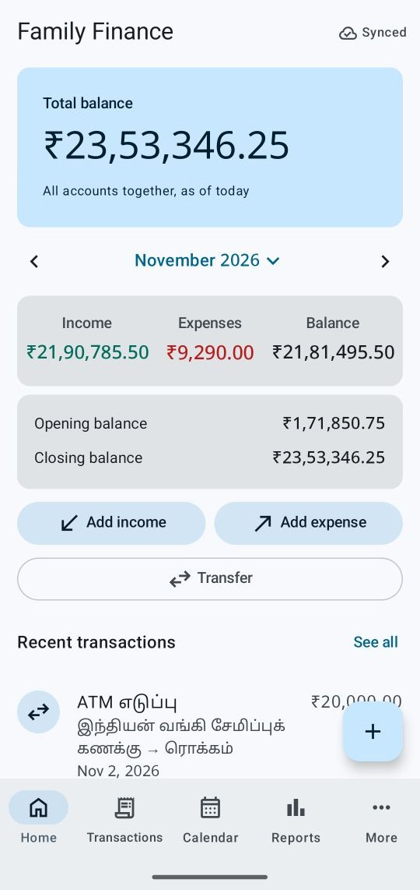&nbsp;
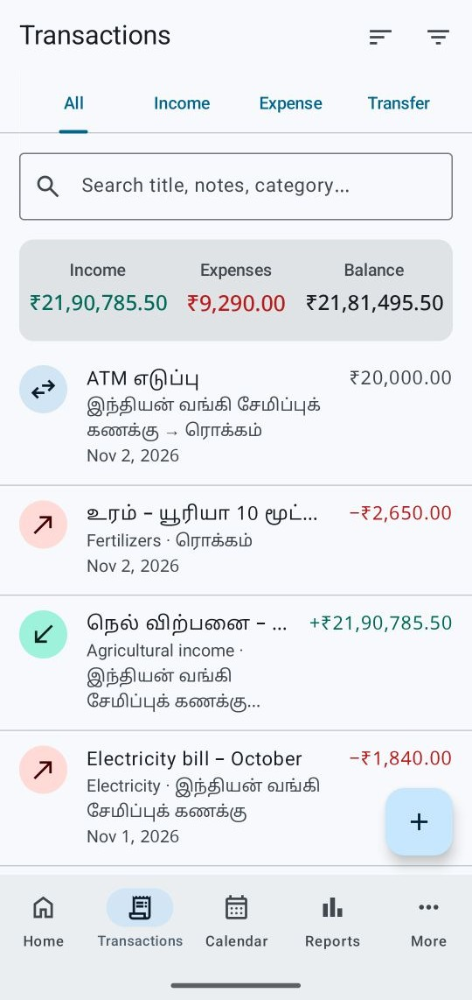&nbsp;
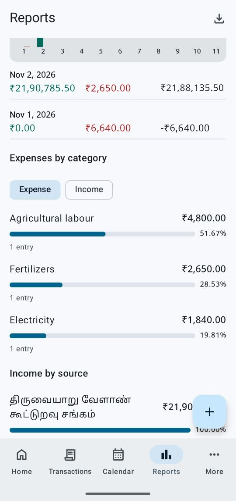&nbsp;
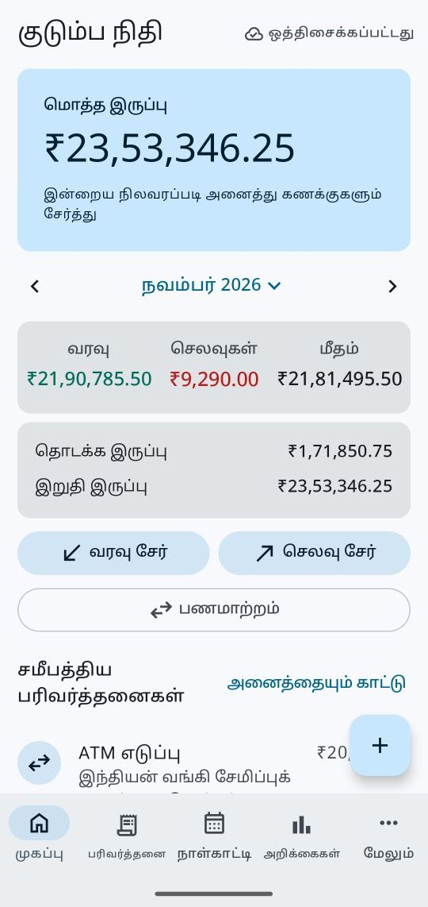

</div>

---

## Contents

- [Why this exists](#why-this-exists)
- [Features](#features)
- [Screenshots](#screenshots)
- [Architecture](#architecture)
- [Money and data rules](#money-and-data-rules)
- [Sync, offline and conflicts](#sync-offline-and-conflicts)
- [Security and privacy](#security-and-privacy)
- [Project structure](#project-structure)
- [Tech stack](#tech-stack)
- [Getting started](#getting-started)
- [Testing](#testing)
- [Documentation](#documentation)
- [Roadmap](#roadmap)
- [License](#license)

## Why this exists

A family that had kept its accounts for years in a generic income/expense app needed something
better suited to how it actually works:

- **Two people share one set of books.** Either phone can add, edit or delete an entry, and both
  stay in sync, even when one of them was offline in the fields all day.
- **Tamil comes first.** Every screen is fully translated, Tamil text typed into an English
  keyboard is stored exactly, and layouts survive the phone's largest font size.
- **Every rupee must reconcile.** Years of old records were imported with matching totals, and
  the app is built so that a balance can never drift from the entries behind it.

It is a private app for one household, not a product. It is published as a worked example of a
small, carefully engineered Android app.

## Features

| | |
|---|---|
| **Income, expenses and transfers** | Amount, title and date are all you need. Account, category and "received from" are optional; a blank account counts as cash and a blank category as "Other". Transfers move money between accounts and are never counted as income or expense. |
| **Accounts and balances** | Cash, bank, card and other accounts with opening balances. Every balance is worked out from the opening balance plus entries, never stored. |
| **Calendar** | Each day's income, expense and net at a glance; tap a day to see its entries. |
| **Reports** | Any period (month, year, custom, all time): totals, trend chart, spending by category, income by source, and per-account opening/closing balances. Tap any row to see the entries behind it. |
| **Exports** | PDF statement, CSV and Excel (.xlsx), in English or Tamil, saved or shared from the phone. |
| **Family sharing** | Google sign-in. The admin invites the other person by Gmail address; both see the same data in real time. |
| **Offline-first sync** | Works fully offline; changes sync when the phone is back online. Edits made on both phones at once are kept and shown side by side to resolve. |
| **Backup and restore** | One-file backups that check themselves when read back. Restoring only ever adds what is missing and never undoes a deletion. |
| **Import from the old app** | Reads the old app's backup database read-only, maps its categories and payment methods, and shows a full report before writing anything. Running it twice cannot duplicate records. |
| **Notebook** | Dated notes for prices, reminders and anything else worth writing down. |
| **Swipe navigation** | Swipe sideways between Home, Transactions, Calendar, Reports and More, or tap the bottom bar. |
| **Private crash log** | If the app ever closes unexpectedly, technical details (no amounts, names or notes) are saved on the phone and can be shared from More > Crash log. Nothing is sent automatically. |

## Screenshots

All screenshots use demo data from the automated screen tour, not real records.

| Home | Transactions | Calendar | Add income |
|:---:|:---:|:---:|:---:|
|  |  | 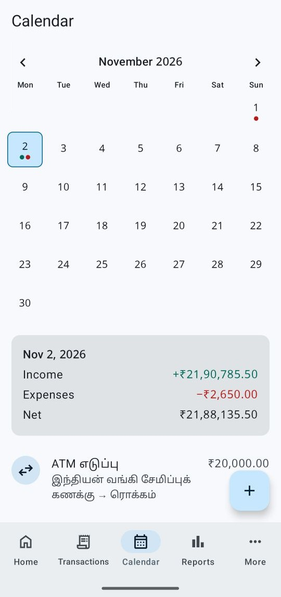 | 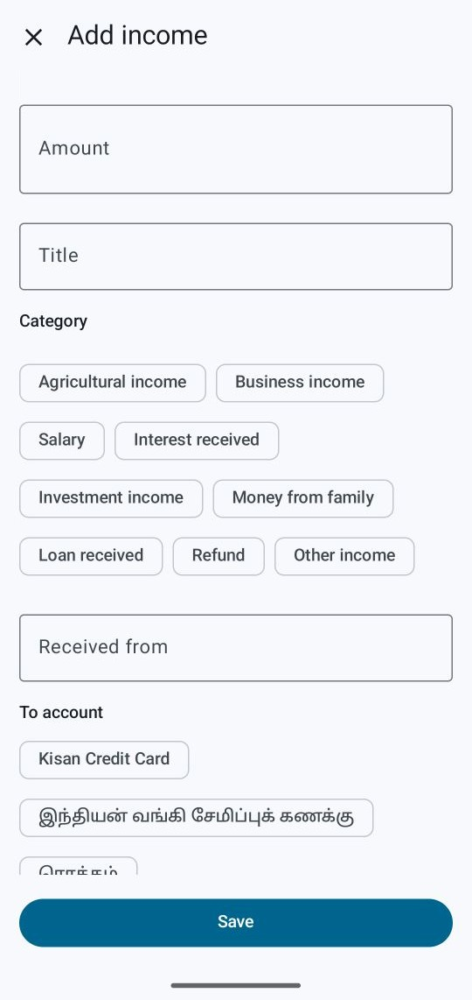 |

| Reports by category | Account summary | Export | Entry detail |
|:---:|:---:|:---:|:---:|
|  | 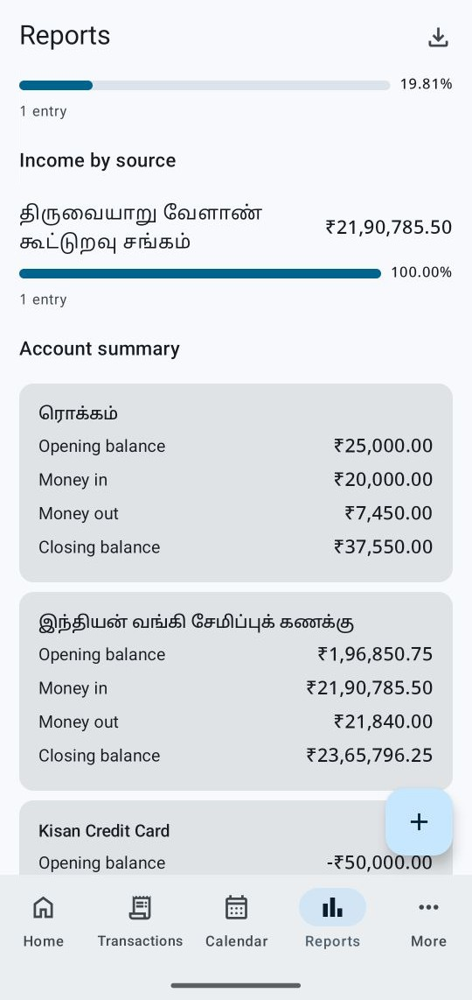 | 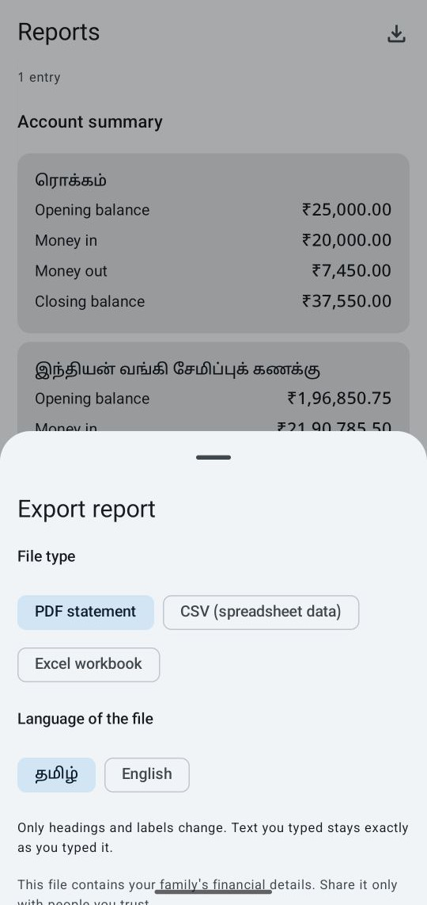 | 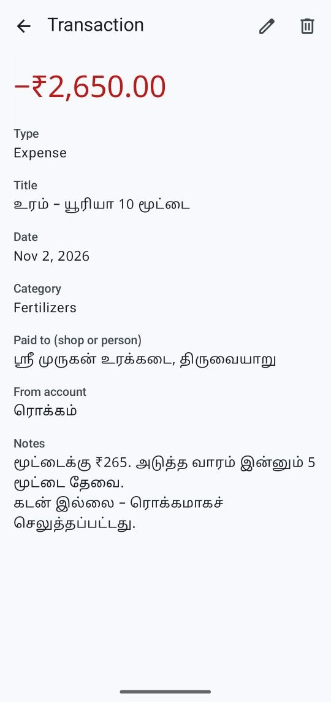 |

| Home (Tamil) | Calendar (Tamil) | Backup and restore | More |
|:---:|:---:|:---:|:---:|
|  | 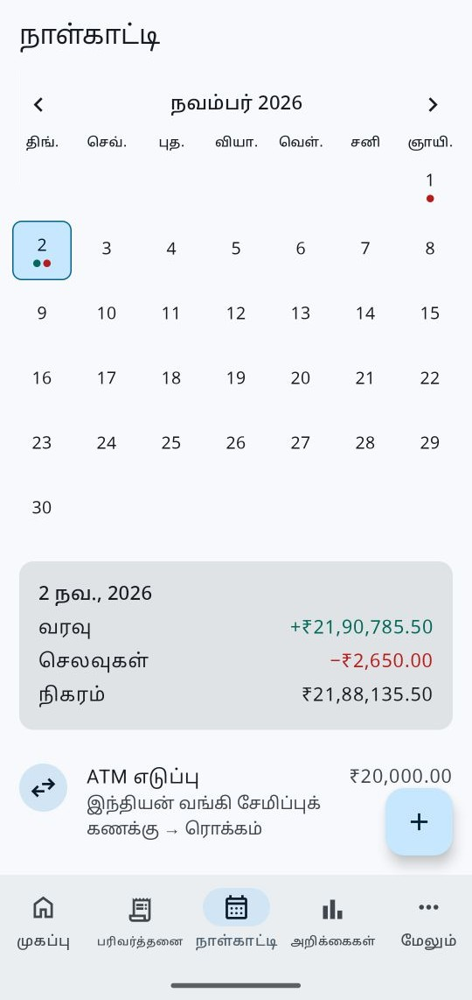 | 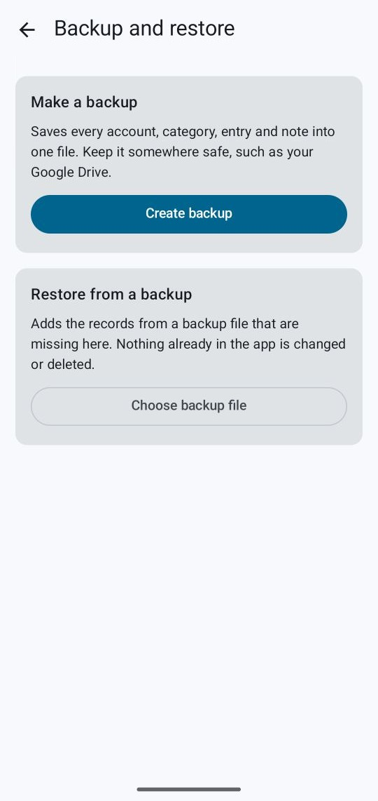 | 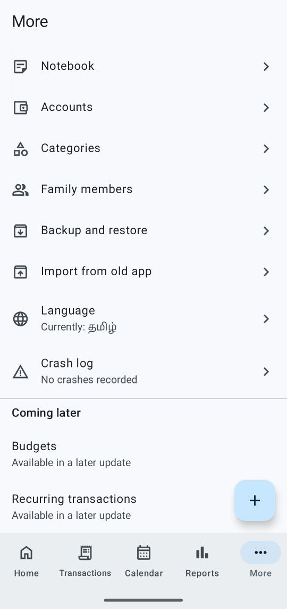 |

## Architecture

A single-module app with three layers and one rule: dependencies point inward, toward the
domain. The domain is pure Kotlin with no Android or Firebase imports, so every financial rule is
tested on the JVM in milliseconds.

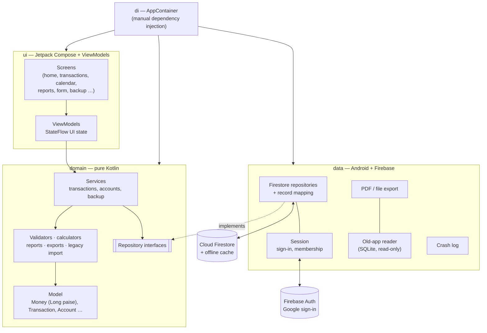

**Key decisions**

- **Manual dependency injection.** One `AppContainer` builds the object graph. For an app this
  size it is simpler to read and debug than a DI framework, and tests swap in in-memory
  repositories with one constructor call.
- **Firestore as the only store.** Its persistent offline cache is the local database, so there is
  no second database to keep consistent.
- **Unidirectional data flow.** Repositories expose `Flow`s; ViewModels combine them into one
  immutable UI state; composables only render state and send events. Composables hold no
  business logic.
- **Navigation Compose** for screens, with the five top-level tabs hosted in one `HorizontalPager`
  so they can be swiped.

## Money and data rules

These rules are enforced in code and covered by unit tests:

| Rule | How |
|---|---|
| Money is never a floating-point number | `Money` is a value class over `Long` paise. Parsing rejects more than two decimals; formatting uses Indian digit grouping (₹1,23,456.78). |
| Balances are derived, never stored | Balance = opening balance + the entries for that account, computed on demand by `BalanceCalculator`. |
| Transfers are neither income nor expense | A transfer is one record that moves money between two accounts; totals ignore it. |
| Amounts stay in a safe range | Every amount is capped at ₹10,000 crore in the forms, the cloud rules, record decoding, backups and the import, so sums can never overflow. |
| Old data is imported exactly | Amounts are converted to paise inside SQLite with an exact-decimals check, so no floating-point value reaches Kotlin. |

## Sync, offline and conflicts

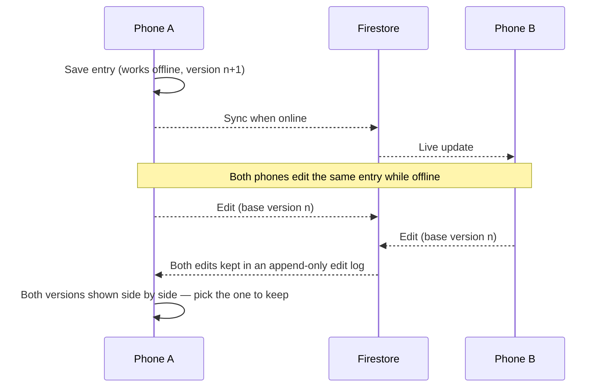

- Every save also appends to an **append-only edit log**, so simultaneous edits are never lost.
- Records are only ever **soft-deleted**, so deletions sync and can be restored from history.
- The status indicator (Synced / Syncing / Offline) reflects pending writes and connectivity.

More detail: [docs/sync-and-conflicts.md](docs/sync-and-conflicts.md).

## Security and privacy

- **Firestore security rules** are the real access control. Only a verified Google account on a
  founders allowlist may create a family; only invited people may join; members can never change
  who created a record. Amounts, dates and IDs are validated on the server too. The rules have
  their own 29-test suite on the local emulator.
- A **removed member** loses access as soon as their phone next reaches the cloud, including the
  copy cached on that phone.
- **No secrets in the repository.** `google-services.json`, signing keys and passwords are
  git-ignored; release signing reads them from a local file.
- **Android backup is disabled** for the app, so financial data never ends up in a device backup.
- The **crash log** never leaves the phone unless the person shares it.
- The codebase went through a full security audit; its findings (amount bounds, revocation,
  restore hardening, stricter membership rules) are fixed and tested.

## Project structure

```
app/src/main/java/com/family/finance/
├── FamilyFinanceApplication.kt   App start: crash log, Firebase setup
├── MainActivity.kt               Single activity
├── di/                           AppContainer — builds the object graph
├── domain/                       Pure Kotlin: no Android, no Firebase
│   ├── model/                    Money, Transaction, Account, Category, built-in categories
│   ├── usecase/                  Services that validate and save records
│   ├── validation/               Form rules and error reasons
│   ├── calc/                     Balances, period totals, calendar summaries
│   ├── report/                   Report building and percentage shares
│   ├── export/                   CSV and Excel writers, statement tables
│   ├── backup/                   Backup format, strict JSON, restore planning
│   ├── legacy/                   Old-app import planning and checks
│   ├── sync/                     Sync state and conflict model
│   └── repository/               Repository interfaces
├── data/                         Android and Firebase implementations
│   ├── firestore/                Repositories, record mapping, live listeners with retry
│   ├── session/                  Sign-in, family membership, invites
│   ├── memory/                   In-memory repositories (tests and previews)
│   ├── preferences/              Last-used account and category
│   ├── backup/                   Reading and writing backup files
│   ├── export/                   PDF statement writer, export files
│   ├── legacy/                   Read-only reader for the old app's database
│   └── crash/                    Private on-phone crash log
└── ui/                           Jetpack Compose, one package per feature
    ├── navigation/               Nav graph, swipeable top-level tabs
    ├── home/ transactions/ calendar/ reports/ more/
    ├── form/ accounts/ categories/ notes/ family/ backup/ session/
    ├── components/ common/       Shared composables, labels, ViewModel helpers
    └── theme/                    Material 3 theme, Tamil-ready typography

app/src/test/            JVM unit tests (domain rules, mapping, ViewModels)
app/src/androidTest/     On-device tests (screen tour, sync, export, import)
firebase/                Firestore rules, indexes and the rules test suite
docs/                    Product spec, sync design, go-live checklist, screenshots
```

## Tech stack

| Area | Choice |
|---|---|
| Language | Kotlin 2.4.21, coroutines 1.11, Flow |
| UI | Jetpack Compose (BOM 2026.09.00), Material 3, Navigation Compose 2.10.2 |
| Architecture | Layered (ui / domain / data), unidirectional data flow, manual DI |
| Backend | Firebase Authentication (Google sign-in via Credential Manager), Cloud Firestore with persistent offline cache (Firebase BoM 35.1.0) |
| Files | Android PDF APIs, a hand-written XLSX writer, RFC 4180 CSV |
| Build | Android Gradle Plugin 9.2.1, Gradle 9.4.1, compileSdk 37, targetSdk 36, minSdk 26 |
| Testing | JUnit 4, Truth, coroutines-test, Compose UI tests, Firebase rules unit testing + emulator |
| Fonts | Noto Sans Tamil (OFL), Material Symbols (Apache 2.0); see [licenses/](licenses) |

## Getting started

**Requirements:** Android Studio with JDK 21, an Android 8.0+ phone or emulator, and your own
Firebase project.

1. **Clone**

   ```bash
   git clone https://github.com/rknishanth152-lgtm/family-finance-manager.git
   ```

2. **Create a Firebase project** with Authentication (Google provider) and Cloud Firestore.
   Add an Android app with package `com.family.finance` and your debug key's SHA-1, then put
   the downloaded `google-services.json` in `app/`.

3. **Publish the security rules** from [firebase/firestore.rules](firebase/firestore.rules)
   (Firebase console > Firestore > Rules), and add your Google email to the `founders`
   collection so you can create a family. See [docs/go-live.md](docs/go-live.md).

4. **Run** the `app` configuration from Android Studio, or:

   ```bash
   ./gradlew installDebug
   ```

Release builds are signed from a local, git-ignored `keystore.properties`; without it they are
simply left unsigned.

## Testing

```bash
# Domain rules, record mapping, backups, reports, exports and ViewModels (JVM)
./gradlew testDebugUnitTest

# Lint
./gradlew lintDebug

# Firestore security rules on the local emulator (needs Node.js and Java 21)
cd firebase && npm install && npm run test:rules
```

| Suite | Count | Covers |
|---|---:|---|
| Unit tests | 195 | Money parsing and formatting, balances, transfers, validation, reports, CSV/XLSX, backup round-trips, restore, old-app import, sync and conflicts, crash log |
| Rules tests | 29 | Who may create, join, read and write; field validation; amount limits; membership changes |
| Device tests | 22 | Screen tour of every screen in both languages at large font sizes (fails on clipped text), two-phone sync, exports, import |

Device tests run with `./gradlew connectedDebugAndroidTest`; the sync tests also need the
Firestore and Auth emulators running.

## Documentation

- [Product requirements](docs/PRD.md): the full specification the app was built against
- [Sync and conflicts](docs/sync-and-conflicts.md): how offline edits, soft deletes and the edit log work
- [Go-live checklist](docs/go-live.md): setting up Firebase, founders, signing and the first import
- [CLAUDE.md](CLAUDE.md): the engineering rules every change follows

## Roadmap

Planned for later updates: budgets, recurring transactions, privacy settings (app lock) and an
About screen.

## License

No open-source license has been chosen yet, so all rights are reserved by the author. The
bundled fonts keep their own licenses in [licenses/](licenses).
